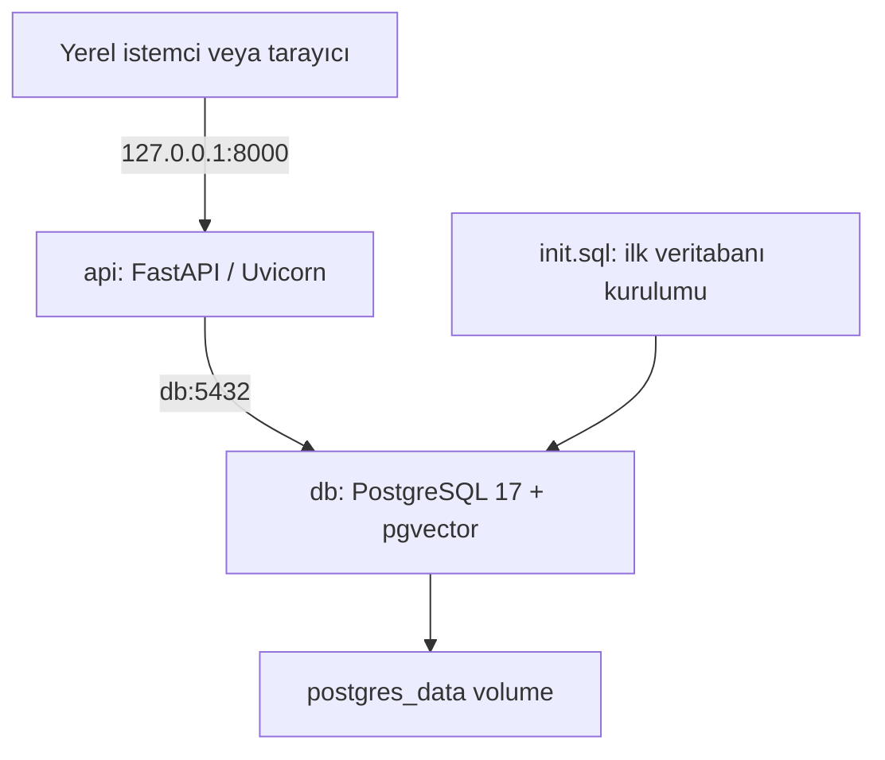
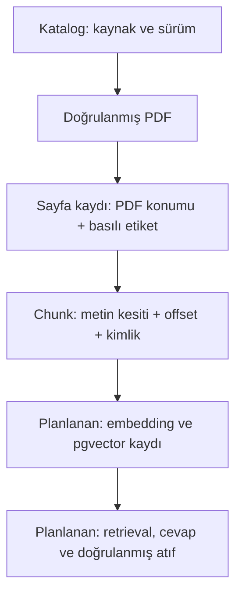

# Policy RAG — Ayrıntılı Proje Rehberi

**Son güncelleme:** 28.10.2026 · **Dil:** Türkçe · **Repo:** [sinemsavas/policy-rag](https://github.com/sinemsavas/policy-rag)

Bu rehber, projenin neden kurulduğunu, bugüne kadar hangi işleri yaptığımızı, her dosyanın görevini, çalıştırma adımlarını ve bundan sonra nasıl ilerleyeceğimizi açıklar. Yeni aşamalar tamamlandıkça aynı dokümantasyon güncellenir. GitHub işlemlerinin ayrıntılı dökümü [GitHub geçmişinde](github-history.md), gelecek işlerin uygulama sırası ve tamamlanma koşulları [yol haritasında](roadmap.md) bulunur.

Uygulamanın bu rehberde açıklanan başlangıç durumu, [26 Ekim tarihli `43b7212` commit'idir](https://github.com/sinemsavas/policy-rag/tree/43b72123f52e9a88a3381ed656d0508f4b28c3e3). Kurulumun 23 Ekim'deki yerel sonuçları çalışma notlarından; commit, dal, PR ve CI bilgileri GitHub kayıtlarından alınmıştır. Tarih ve saat tablolarında Europe/Berlin kullanılır. Planlanan özellikler ilgili bölümlerde ayrıca belirtilir.

## İçindekiler

1. [Projenin amacı ve bugünkü durumu](#amac)
2. [Başlangıçtan bugüne çalışma sırası](#calisma-sirasi)
3. [Teknolojiler ve görevleri](#teknolojiler)
4. [Dosyalar ve dokümantasyon haritası](#dosyalar)
5. [Yerel ortam, ayarlar ve Docker mimarisi](#altyapi)
6. [API'nin mevcut davranışı](#api)
7. [Git ve GitHub çalışma düzeni](#git)
8. [İlk belge koleksiyonu ve indirme](#koleksiyon)
9. [PDF'den sayfa kayıtlarına geçiş](#metin-cikarma)
10. [Sayfa kayıtlarından chunk üretimi](#chunking)
11. [Kaynak takibi ve veri sözleşmeleri](#veri-sozlesmeleri)
12. [Testler, CI ve sonuçların anlamı](#testler)
13. [Uçtan uca çalıştırma kılavuzu](#calistirma)
14. [Karşılaşılan sorunlar ve çözümler](#sorunlar)
15. [Gelecek aşamalar ve güncelleme düzeni](#guncelleme)
16. [Kısa sözlük](#sozluk)

<a id="amac"></a>
## 1. Projenin amacı ve bugünkü durumu

Policy RAG'in hedefi, halka açık sigorta belgelerine soru sorulabilen ve cevabın hangi belge ile hangi sayfaya dayandığının görülebildiği bir uygulama geliştirmektir. RAG, önce soruyla ilgili kaynak parçalarını bulur; ardından dil modeli bu kanıtlardan yararlanarak cevap üretir. Bu projede kaynak bulma ve cevap üretme ayrı ayrı değerlendirilecektir.

Nihai davranışta desteklenen bir cevap kaynak göstermeli, atıf gerçekten getirilen parçaya bağlanmalı ve belgeler yeterli kanıt sunmuyorsa sistem bunu açıkça belirtmelidir. Bu davranışların gereksinimleri [SPEC.md](../SPEC.md) içinde yazılıdır; cevap üreten uygulama henüz geliştirilmemiştir.

Proje aynı zamanda backend geliştirme, veri hazırlama, izlenebilir kaynak yönetimi, test, değerlendirme, konteynerleştirme ve ileride AWS üzerinde sunumu gösterecek bir portföy çalışmasıdır. Tamamlanma ölçütü, ilgili özelliğin kodu ve doğrulama kanıtının bulunmasıdır.

| Alan | Mevcut durum | Eldeki kanıt |
| --- | --- | --- |
| Yerel geliştirme temeli | Tamamlandı | Ubuntu/WSL kurulumu ve önceki yerel çalışma notları |
| API ve veritabanı | Tamamlandı | FastAPI, Compose, PostgreSQL ve pgvector dosyaları |
| Sağlık kontrolleri | Uygulandı | `/health`, `/ready`; sağlık smoke testi |
| Repo, README, SPEC ve CI | Tamamlandı | İlk commit ve PR #1 |
| Belge koleksiyonu ve indirme | Tamamlandı | Üç kaynak, katalog, doğrulamalı indirici; PR #3 |
| Sayfa metni çıkarma | Tamamlandı | 47 sayfa kaydı; PR #4 |
| Chunking | Tamamlandı | Varsayılan ayarda 225 chunk; PR #5 |
| Embedding ve veritabanına içerik yükleme | Planlandı | [Sonraki aşama](roadmap.md#embedding) |
| Anlamsal arama ve kaynaklı cevap | Planlandı | SPEC R-01–R-07 |
| Evaluation, monitoring ve arayüz | Planlandı | SPEC E-01–E-04, D-01 |
| AWS, Bedrock ve MCP | Planlandı | SPEC D-02–D-03 |

Bugün PDF'lerden kaynak bilgileri korunarak chunk dosyaları oluşturabiliyoruz. Bu parçalar henüz embedding'e çevrilmedi ve PostgreSQL'e yüklenmedi. Mevcut API'de soru-cevap endpoint'i bulunmuyor. `/ready` sonucunun başarılı olması, veritabanına erişildiğini ve vector eklentisinin etkin olduğunu gösterir; belge indeksinin hazır olduğunu göstermez.

<a id="calisma-sirasi"></a>
## 2. Başlangıçtan bugüne çalışma sırası

### 23.10.2026 — Çalışan yerel temel

Windows üzerinde Ubuntu/WSL ortamı kullanıldı. Git, Docker ve Docker Compose'un çalışması doğrulandı. `uv 0.13.5` ve kullanıcı ortamında Python `3.12.15` kuruldu. Başlangıçtaki `uv: command not found` sorunu, kurulumun ortam ayarlarının terminale yüklenmesiyle çözüldü.

Proje `~/projects/policy-rag` klasöründe oluşturuldu. Python bağımlılıkları `pyproject.toml` içinde tanımlandı; çözümlenen sürümler `uv.lock` ile kaydedildi. Projeye özel `.venv` ortamı kullanıldı. FastAPI, Uvicorn, Pydantic, Pydantic Settings ve psycopg ile ilk API hazırlandı.

PostgreSQL 17 ve pgvector 0.8.7 içeren veritabanı servisi oluşturuldu. `init.sql` vector eklentisini etkinleştirdi. API için Dockerfile hazırlandı ve uygulamanın ayrı bir kullanıcıyla çalışması sağlandı. Compose, `api` ve `db` servislerini birleştirdi; veritabanı dosyaları için kalıcı volume tanımlandı.

Bu aşamanın yerel sonucunda iki servis de `healthy` durumundaydı ve `/ready`, `{"status":"ok"}` dönüyordu. Bu tarih yerel çalışmanın tarihidir; GitHub'daki ilk commit'in tarihi 24 Ekim'dir.

### 24.10.2026 — GitHub, dokümantasyon ve ilk CI

`sinemsavas/policy-rag` reposu oluşturuldu. Çalışan proje ilk commit ile gönderildi. GitHub CLI'ın tarayıcı açamaması, cihaz giriş adresinin Windows tarayıcısında elle açılmasıyla aşıldı. Git'in GitHub CLI üzerinden HTTPS kimlik doğrulaması yapması ayarlandı.

PR #1 ile boş değerli `.env.example`, kurulum ve mimari README'si, numaralı kabul kriterlerini içeren SPEC, veritabanından bağımsız `/health` testi ve GitHub Actions iş akışı eklendi. `pytest` ve `httpx` geliştirme bağımlılıklarına alındı; mevcut uygulama bağımlılıklarının kilitli sürümleri korundu. Yerelde ve GitHub'da ilk test başarılı oldu: **1 passed**.

### 26.10.2026 — Belge hazırlama hattı

PR #2 ile README proje kurulumu ve kapsamına odaklanacak şekilde sadeleştirildi. Ardından üç FEMA/NFIP formu seçilerek belge kataloğu ve doğrulamalı indirme komutu PR #3'te eklendi. Toplam test sayısı 10'a çıktı.

PR #4, PDF'nin doğru bölümünü seçerek belge ve sayfa bilgilerini koruyan metin çıkarma aşamasını ekledi. Üç formdan toplam 47 sayfa kaydı üretildi ve 26 test geçti.

PR #5, bu sayfa kayıtlarını yapılandırılabilir boyut ve örtüşmeyle parçalara bölen chunking aşamasını ekledi. Varsayılan `1200/200` ayarı 225, karşılaştırma için kullanılan `800/120` ayarı 328 chunk üretti. Test sayısı 75'e ulaştı. Bu beş PR `main` dalına birleştirildi ve her birinin ilgili CI çalışmaları başarılı oldu.

### 28.10.2026 — Birleşik proje dokümantasyonu

Bu rehber, ayrıntılı GitHub işlem geçmişi ve ileri aşamalar için uygulama/kabul planı hazırlandı. README'den bu belgelere erişim eklendi. Belge kataloğundaki eski durum cümlesi, chunking'in tamamlandığını gösterecek şekilde güncellendi. Bu dokümantasyon çalışması uygulamanın mevcut davranışını değiştirmez.

<a id="teknolojiler"></a>
## 3. Teknolojiler ve görevleri

| Teknoloji | Projedeki görevi | Seçimin/pratiğin anlamı |
| --- | --- | --- |
| Ubuntu / WSL | Windows üzerinde Linux geliştirme ortamı | Terminal, dosya yolları ve Docker ile yerel çalışma |
| Python 3.12 | Backend ve veri hazırlama dili | Belgelenen geliştirme tabanı 3.12; paket tanımı `>=3.12` |
| uv 0.13.5 | Python ve bağımlılık yönetimi | Proje ortamı, kilitli kurulum ve komut çalıştırma |
| FastAPI / Uvicorn | HTTP API ve uygulama sunucusu | Sağlık endpoint'leri ve otomatik OpenAPI arayüzü |
| Pydantic | Veri şemaları ve doğrulama | Yanıt, kaynak kataloğu, sayfa ve chunk kayıtları |
| Pydantic Settings | Ortam ayarlarını okuma | `.env` ve ortam değişkenlerinden yapılandırma |
| psycopg | PostgreSQL bağlantısı | Mevcut `/ready` sorgusu; sonraki veri yükleme adımları |
| PostgreSQL 17 | İlişkisel veri tabanı | Şimdilik çalışan altyapı; içerik tabloları sonraki aşama |
| pgvector 0.8.7 | PostgreSQL'de vektör saklama ve arama desteği | Eklenti etkin; henüz embedding verisi yüklenmedi |
| Docker / Compose | Servislerin birlikte çalışması | API ve veritabanı için tanımlı ortam, ağ ve sağlık kontrolleri |
| pypdf 6.21.2, font desteği | Metin tabanlı PDF okuma | İncelenen CFR belgelerindeki yazı tipleri ve sayfa metni |
| pytest / httpx | Otomatik test | API cevabı ve veri hazırlama kurallarının doğrulanması |
| Git / GitHub | Sürüm ve değişiklik takibi | Commit, dal, PR, birleştirme ve kod inceleme izi |
| GitHub Actions | Otomatik CI | Her push ve PR'da kilitli bağımlılıklarla test çalıştırma |

`pyproject.toml` paketlerin izin verilen sürüm aralıklarını, `uv.lock` belirli kurulum için çözümlenen sürümleri taşır. `--locked`, kilit dosyasının proje tanımıyla uyumsuz olması halinde kurulumun sessizce başka sürümler seçmesini engeller. Python'un yama sürümüyle paketlerin kilitli sürümleri farklı kavramlardır; kullanıcı ortamındaki `3.12.15`, bütün makinelerin aynı yama sürümünde olduğu anlamına gelmez.

<a id="dosyalar"></a>
## 4. Dosyalar ve dokümantasyon haritası

### 4.1 Uygulama ve altyapı dosyaları

| Dosya | Ne yapar? | Ne zaman değiştirilir? |
| --- | --- | --- |
| [main.py](../main.py) | Ayarları, FastAPI uygulamasını ve iki sağlık endpoint'ini tanımlar. | API davranışı veya ayar sözleşmesi değiştiğinde |
| [pyproject.toml](../pyproject.toml) | Proje bilgilerini ve çalışma/geliştirme bağımlılıklarını tanımlar. | Paket eklendiğinde veya sürüm kısıtı değiştiğinde |
| [uv.lock](../uv.lock) | Çözümlenen paket sürümlerini ve dağıtım bilgilerini kaydeder. | Bağımlılıklar uv ile güncellendiğinde |
| [Dockerfile](../Dockerfile) | API imajını oluşturur, kilitli bağımlılıkları kurar, normal kullanıcıyla Uvicorn başlatır. | İmaj veya çalışma şekli değiştiğinde |
| [compose.yaml](../compose.yaml) | `api` ve `db`, portlar, ortam değişkenleri, sağlık kontrolleri ve volume'ü tanımlar. | Servis düzeni veya yerel bağlantılar değiştiğinde |
| [init.sql](../init.sql) | İlk veritabanı oluşturulurken vector eklentisini açar. | Başlangıç kurulumu değiştiğinde; mevcut veritabanı geçişlerinin yerini tutmaz |
| [.env.example](../.env.example) | Gerekli üç değişkenin adını boş değerlerle gösterir. | Yeni zorunlu yapılandırma eklendiğinde |
| [.gitignore](../.gitignore) | Gerçek ayarları, sanal ortamı, önbellekleri ve üretilen veriyi Git dışında tutar. | Yeni yerel çıktı türü oluştuğunda |
| [.dockerignore](../.dockerignore) | Gereksiz veya özel dosyaları Docker build bağlamından çıkarır. | Yeni yerel çıktı veya özel dosya türü oluştuğunda |
| [.github/workflows/ci.yml](../.github/workflows/ci.yml) | CI tetikleyicilerini, ortamı ve test komutlarını tanımlar. | Otomatik kontrol veya build adımı eklendiğinde |

### 4.2 Veri hazırlama ve test dosyaları

| Dosya | Görevi |
| --- | --- |
| [scripts/__init__.py](../scripts/__init__.py) | Script'lerin `python -m scripts...` biçiminde modül olarak kullanılmasını sağlar. |
| [scripts/download_corpus.py](../scripts/download_corpus.py) | Kataloğu doğrular, PDF'leri indirir ve içerik parmak izlerini kontrol eder. |
| [scripts/extract_corpus.py](../scripts/extract_corpus.py) | Hedef poliçe bölümünden sayfa kayıtları üretir. |
| [scripts/chunk_corpus.py](../scripts/chunk_corpus.py) | Sayfa içi chunk'lar ve koşu raporu üretir. |
| [tests/test_health.py](../tests/test_health.py) | `/health` yanıtını ve veritabanından bağımsızlığını doğrular. |
| [tests/test_download_corpus.py](../tests/test_download_corpus.py) | İndirme, içerik doğrulama, önbellek ve hata davranışlarını sınar. |
| [tests/test_extract_corpus.py](../tests/test_extract_corpus.py) | Gerçek küçük test PDF'leriyle bölüm sınırlarını ve sayfa metadata'sını sınar. |
| [tests/test_chunk_corpus.py](../tests/test_chunk_corpus.py) | Parça sınırlarını, kapsama, kimlik, ayar ve hatalı girdi kurallarını sınar. |

### 4.3 Hangi doküman hangi soruya cevap verir?

| Doküman | İçeriği |
| --- | --- |
| [README.md](../README.md) | Projeye hızlı giriş, kurulum, komutlar ve mevcut kapsam |
| [SPEC.md](../SPEC.md) | Amaç, kısıtlar, numaralı kabul kriterleri ve gereken kanıt |
| [project-guide.md](project-guide.md) | Bu ayrıntılı Türkçe anlatım ve çalışma kılavuzu |
| [github-history.md](github-history.md) | Commit, dal, PR, değişen dosyalar ve CI/push kayıtları |
| [roadmap.md](roadmap.md) | Yapılacak işlerin gerekçesi, sırası ve tamamlanma koşulları |
| [corpus.md](corpus.md) | İlk koleksiyonun kapsamı, sürümü, kaynak ve kullanım inceleme notları |
| [corpus.json](corpus.json) | Programların okuduğu belge kimlikleri, adresler, boyutlar, hash'ler ve bölüm sınırları |
| [extraction.md](extraction.md) | Çıkarma profili, sayfa kayıt sözleşmesi ve desteklenen PDF yapısı |
| [chunking.md](chunking.md) | Chunk algoritması, deney ayarları, kayıt sözleşmesi ve gözlenen sayılar |
| [chunking.json](chunking.json) | Programın okuduğu varsayılan `page-char-v1`, `1200/200` ayarı |

README kısa kullanım kapısıdır; SPEC beklenen davranışın sözleşmesidir. Bu rehber kararların ve parçaların birlikte nasıl çalıştığının açıklamasını verir. Makine tarafından okunan JSON ayarları değiştiğinde, açıklama dokümanları da aynı değişiklikte güncellenmelidir.

### 4.4 Yerelde oluşan dosyalar

| Konum | İçerik | Git'e girer mi? |
| --- | --- | --- |
| `.env` | Kullanıcının gerçek yerel ayarları | Hayır |
| `.venv/` | Python sanal ortamı | Hayır |
| `data/raw/` | Üç doğrulanmış kaynak PDF | Hayır |
| `data/processed/` | Belge başına `.pages.jsonl` | Hayır |
| `data/chunks/page-char-v1-1200-200/` | Varsayılan chunk dosyaları ve `report.json` | Hayır |
| `data/chunks/page-char-v1-800-120/` | İkinci ayara ait ayrı chunk dosyaları ve rapor | Hayır |
| Docker'ın `postgres_data` volume'ü | PostgreSQL veri dosyaları | Repo dosyası değildir |

Kaynak PDF'ler ile üretilen çıktıları Git dışında tutuyoruz. Yeniden üretim için gereken katalog, ayarlar, kod ve kilitli bağımlılıklar repoda tutuluyor.

<a id="altyapi"></a>
## 5. Yerel ortam, ayarlar ve Docker mimarisi

### 5.1 Proje ortamı

Çalışma klasörü Ubuntu'da `~/projects/policy-rag` olarak kullanıldı. `uv sync --locked --group dev`, kilitli çalışma bağımlılıklarıyla birlikte test paketlerini kurar. `uv run --locked ...`, komutu proje ortamında çalıştırır. Sanal ortamı elle etkinleştirmek gerekmez.

İlk kurulum ile var olan projeyi güncelleme farklı işlemlerdir. Yeni kurulumda örnek ayar dosyası kopyalanıp doldurulur; çalışan kurulumda mevcut `.env` korunur. Docker ile API'yi başlatmak için yerel Python kurulumu gerekmez; veri hazırlama ve geliştirme testleri için Python/uv gerekir.

### 5.2 Yapılandırma değişkenleri

| Değişken | Anlamı | Mevcut davranış |
| --- | --- | --- |
| `POSTGRES_DB` | Veritabanı adı | `.env` içinde doldurulmalı |
| `POSTGRES_USER` | Veritabanı kullanıcı adı | `.env` içinde doldurulmalı |
| `POSTGRES_PASSWORD` | Veritabanı parolası | `.env` içinde doldurulmalı; uygulamada `SecretStr` |
| `POSTGRES_HOST` | API'nin bağlanacağı sunucu | Yerel varsayılan `127.0.0.1`; Compose API'sinde `db` |
| `POSTGRES_PORT` | PostgreSQL portu | Varsayılan ve Compose değeri `5432` |

Örnek dosyada yalnızca ilk üç değişken vardır ve değerleri boştur. Host ve port için mevcut kodun varsayılanları kullanılır; Compose API'ye kendi değerlerini verir. Ayarlar uygulama modülü içe aktarılırken oluşturulur. `/health` veritabanına bağlanmaz, fakat uygulamanın başlayabilmesi için gerekli ayar alanlarının sağlanmış olması gerekir. Smoke test bu alanları geçici test değerleriyle doldurur.

### 5.3 İki servis nasıl konuşuyor?



Compose ağı içinde `db`, veritabanı servisinin adıdır. API container'ında `127.0.0.1` kullanılsaydı API kendi container'ına bağlanmaya çalışırdı. Bu nedenle Compose ortamında host açıkça `db` olarak ayarlanır. Ubuntu'da doğrudan çalışan API ise hosta yayınlanan PostgreSQL portuna `127.0.0.1:5432` üzerinden erişir.

Hosta açılan 8000 ve 5432 portları loopback adresine bağlanmıştır. Veritabanı servisi `pg_isready` ile kontrol edilir. API'nin başlaması için `db` sağlık kontrolünü geçmelidir. API container'ının kendi sağlık kontrolü `/ready` çağırır; böylece sadece HTTP sunucusunu değil, veritabanı ve eklenti kullanılabilirliğini de gözler.

### 5.4 Kalıcılık ve ilk kurulum SQL'i

`postgres_data`, container yeniden oluşturulduğunda veritabanı dosyalarının korunmasını sağlar. `init.sql`, boş veri diziniyle ilk PostgreSQL kurulumu sırasında `CREATE EXTENSION IF NOT EXISTS vector;` çalıştırır.

Çalışan bir veritabanının `.env` parolasını değiştirmek, veritabanındaki kullanıcının parolasını otomatik değiştirmez. Benzer şekilde `init.sql` dosyasına sonradan satır eklemek, mevcut volume üzerinde otomatik geçiş uygulamaz. İleride tablo/şema değişiklikleri için açık bir migration düzeni kurulacaktır.

### 5.5 API imajı

Dockerfile Python 3.12 tabanını ve uv 0.13.5'i kullanır. Önce `pyproject.toml` ve `uv.lock` kopyalanır; `uv sync --locked --no-dev --no-install-project` ile çalışma bağımlılıkları kurulur. Sonra `main.py` eklenir. Uvicorn, UID 10001 olan `appuser` ile 8000 portunda başlar.

Mevcut imaj yalnızca API'yi çalıştıracak dosyaları kopyalar. Veri hazırlama script'leri Ubuntu'daki proje ortamından çalıştırılır. PDF indirme veya chunk üretme işlemi, `docker compose up` komutunun içinde otomatik yapılmaz.

<a id="api"></a>
## 6. API'nin mevcut davranışı

| Adres | Kontrol ettiği şey | Başarılı sonuç | Hata veya sınır |
| --- | --- | --- | --- |
| `GET /health` | API'nin istek karşılaması | HTTP 200, `{"status":"ok"}` | DB sorgulamaz; uygulamanın önceden başlamış olması gerekir |
| `GET /ready` | PostgreSQL bağlantısı ve vector eklentisi | HTTP 200, `{"status":"ok"}` | Bağlantı/sorgu hatası veya eksik eklentide HTTP 503 |
| `/docs` | OpenAPI arayüzü | İnteraktif API dokümantasyonu | Mevcut endpoint'leri gösterir |
| `/` | Tanımlı rota yok | HTTP 404 | Normaldir |

`/ready`, psycopg ile bağlantı açar ve `pg_extension` tablosunda `vector` eklentisinin sürümünü sorgular. Bağlantı zaman aşımı üç saniye, sorgu zaman aşımı 3000 milisaniye olarak ayarlanmıştır. Bağlantı/sorgu hatası `Database unavailable`, eklenti yokluğu `pgvector is not enabled` detayıyla 503 döner.

Bu iki endpoint'in ayrılması, uygulama ayakta olmasına rağmen veritabanının kullanılamadığı durumu ayırt etmeyi sağlar. `/ready` için hata yollarını gerçek veritabanıyla sınayan entegrasyon testleri gelecek çalışmadır.

<a id="git"></a>
## 7. Git ve GitHub çalışma düzeni

### 7.1 Kavramların farkı

| Kavram | Bu projedeki anlamı |
| --- | --- |
| Working tree | Bilgisayardaki düzenlenebilir dosyalar |
| Staging | Bir sonraki commit'e girecek değişikliklerin seçilmesi |
| Commit | Seçilen dosya durumunun Git geçmişine kaydı |
| Branch / dal | Bir çalışma kolunun belirli commit'e işaret etmesi |
| `origin` | GitHub reposu için kullanılan uzak bağlantı adı |
| Push | Yereldeki commit/ref değişikliklerinin GitHub'a gönderilmesi |
| Pull request / PR | Bir daldaki değişikliğin `main` ile karşılaştırılması ve birleştirme kaydı |
| Merge / birleştirme | PR değişikliğinin hedef dala alınması |
| Pull | GitHub'daki yeni geçmişin yerel kopyaya alınması |
| CI | Push/PR gibi olaylarda testlerin otomatik çalışması |

`git push` yalnızca kaydedilmiş commit'leri gönderir. Dosya düzenlemek tek başına commit oluşturmaz. `Everything up-to-date`, ilgili uzak dala gönderilecek yeni commit olmadığını söyler; tek başına çalışma klasöründeki bütün değişikliklerin kaydedildiğini kanıtlamaz. Bunun için `git status` ve commit geçmişi de kontrol edilir.

### 7.2 İlk GitHub aktarımında yaptıklarımız

Yerel repo başlatıldı, proje için kullanıcı adı/e-posta ayarlandı ve gerçek `.env` dosyasının Git dışında olduğu kontrol edildi. Uygulama ve altyapı dosyaları tek tek staging'e alındı. İlk commit mesajı `feat: bootstrap containerized FastAPI and pgvector` oldu. Ana dal `main` olarak adlandırıldı ve `origin`, `https://github.com/sinemsavas/policy-rag.git` adresine bağlandı.

GitHub CLI cihaz girişiyle `sinemsavas` hesabında yetkilendirildi. Tarayıcı Ubuntu'dan otomatik açılamadığı için `github.com/login/device` Windows tarayıcısında açıldı ve terminal kodu oraya girildi. `gh auth setup-git --hostname github.com`, Git'in CLI kimlik doğrulamasını kullanmasını sağladı. İlk aktarımın ardından repo dosyaları GitHub'dan okunarak doğrulandı.

### 7.3 Sonraki değişikliklerde kullanılan akış

PR #1–#5 için ayrı çalışma dalları oluşturuldu. İlgili kod/doküman/testler aynı değişiklikte hazırlandı; dal ve PR üzerinde CI çalıştı. Kontroller sonrasında değişiklikler `main` dalına alındı. Mevcut kayıtlarda her PR, `main` üzerinde tek commit'e indirilmiştir; buna **squash merge** denir.

Bu nedenle PR'daki çalışma commit'inin SHA'sı ile `main` dalındaki sonuç commit'inin SHA'sı farklıdır. İkisi de [ayrıntılı geçmişte](github-history.md) bulunur. Ayrıca bir dalın oluşturulduğu mevcut commit için de push CI görülebilir; bu olay yeni uygulama özelliği eklendiği anlamına gelmez.

Yeni bir çalışma için kullanılabilecek yerel düzen:

```bash
git status --short
git switch main
git pull --ff-only origin main
git switch -c docs/ornek-calisma
```

Dosyalar düzenlendikten sonra ilgili yollar açıkça seçilir:

```bash
git add docs/project-guide.md
git diff --cached --stat
git diff --cached
git commit -m "docs: update project guide"
git push -u origin docs/ornek-calisma
```

Bu komutlar yeni bir çalışma örneğidir; mevcut doküman değişikliğini tekrar oluşturmak için çalıştırılmaz. `git status` kaydedilmemiş değişiklik gösteriyorsa dal değiştirme/güncelleme öncesi o değişikliklerin durumu değerlendirilir. Birleştirilmiş çalışmayı bilgisayara almak için normal komut `git pull --ff-only origin main` olur.

### 7.4 Neden `--ff-only`?

Bu seçenek yerel dalın uzaktaki dala doğrudan ilerletilebildiği durumda günceller. Geçmişler ayrışmışsa otomatik bir birleştirme commit'i oluşturmak yerine durur. Bu durumda önce `git status` ve iki tarafın commit'leri incelenir; rastgele reset veya force push kullanılmaz.

<a id="koleksiyon"></a>
## 8. İlk belge koleksiyonu ve doğrulamalı indirme

### 8.1 Neden bu üç belge?

Küçük, aynı sürümden gelen, kişisel veri içermeyen ve sayfa düzeyinde atıf yapılabilen bir başlangıç koleksiyonu seçildi. Koleksiyon, FEMA'nın National Flood Insurance Program kapsamındaki Standard Flood Insurance Policy formlarından oluşur. Kaynak, GovInfo'nun **1 Ekim 2025** tarihli yıllık CFR sürümüdür.

Üç formdaki benzer hükümler ileride yanlış poliçe türünün getirilip getirilmediğini sınamak için yararlı olacaktır. Bu seçim, bütün sigorta türlerinin kapsandığı anlamına gelmez. Başlangıç belge dili İngilizcedir; Türkçe ve İngilizce sorguların birlikte desteklenmesi henüz doğrulanmış bir özellik değildir.

| Form | Belge kimliği | Bölüm | PDF / basılı sayfalar |
| --- | --- | --- | --- |
| Dwelling | `nfip-dwelling-2025-10-01` | 44 CFR Part 61, Appendix A(1) | 16 / 156–171 |
| General Property | `nfip-general-property-2025-10-01` | Appendix A(2) | 15 / 171–185 |
| RCBAP | `nfip-rcbap-2025-10-01` | Appendix A(3) | 16 / 185–200 |

PDF sayıları toplamı 47'dir. Sınır sayfaları komşu bölümleri paylaştığı için bu sayı 47 farklı basılı sayfa anlamına gelmez. Her form kendi hedef metnini ayrı taşır.

### 8.2 Katalogda neleri saklıyoruz?

`docs/corpus.json` içinde koleksiyon kimliği, şema sürümü, kaynak inceleme notu ve belge listesi bulunur. Her belgede kimlik, başlık, yazar/yayıncı, dil, sürüm tarihi, kaynak URL'si, dosya adı, byte boyutu, SHA-256, PDF sayfa sayısı, basılı sayfa aralığı ve bölüm sınırları tutulur.

Katalogdaki kullanım incelemesi 26.10.2026 tarihlidir ve incelenen ABD kamu düzenleme metnine ilişkin dayanağı kaydeder. Mühür, marka ve üçüncü taraf içerikler bu incelemenin dışında bırakılmıştır. Ham PDF'ler repoda dağıtılmaz. Yeni belge eklemek, mevcut incelemeyi otomatik olarak o belgeye uygulamak anlamına gelmez; yeni kaynağın koşulları ayrıca kaydedilir.

### 8.3 İndirme komutunun yaptığı kontroller

```bash
uv run --locked python -m scripts.download_corpus
```

Önce Pydantic kataloğu doğrular. Belge kimliklerinin tekil olması, kaynakların HTTPS kullanması, dosya adının belge kimliğine uyması ve boyut sınırları gibi kurallar uygulanır. Böylece hatalı katalog ve dosya yolu girişleri işlem başında yakalanır.

Dosya mevcutsa indirici kayıtlı boyutu ve SHA-256'yı kontrol eder. Eşleşiyorsa `verified ... (cached)` yazar. Yeni indirmede ağ zaman aşımı 30 saniyedir; okuma beklenen boyuttan bir byte fazlasıyla sınırlandırılır. Gelen içeriğin `%PDF-` başlığı, tam boyutu ve SHA-256'sı eşleşmeden dosya yayımlanmaz.

Doğru içerik önce geçici dosyaya yazılır, ardından hedef dosyanın yerine taşınır. Hatalı yeni içerik kaydedilmez; var olan bozuk/değişmiş dosya incelenebilmesi için korunur ve komut sıfır dışı sonuçla durur. Bir hash uyuşmazlığı, katalogdaki hash'i doğrulamasız değiştirme gerekçesi değildir.

İndirici PDF'nin byte kimliğini doğrular. Belge yapısının, sayfa etiketlerinin ve hedef poliçe bölümünün kontrolü sonraki aşamadadır. Üç dosyanın indirilmesi tek bir toplu transaction değildir; sonraki dosyada hata olsa bile önceki doğru indirmeler kalabilir.

<a id="metin-cikarma"></a>
## 9. PDF'den sayfa kayıtlarına geçiş

### 9.1 Çözmemiz gereken sorun

GovInfo dosyalarının ilk ve son sayfaları yalnızca hedef formu içermiyordu. Dwelling dosyası önceki 61.17 bölümünün sonunu ve sonraki A(2) bölümünün başlangıcını; General Property dosyası A(1) ve A(3) sınırlarını; RCBAP dosyası A(2) ve Part 62 sınırlarını taşıyordu.

Bütün dosyayı düz metin olarak almak, yanlış poliçe metninin bir formun kaydı içine girmesine yol açardı. Sınır sayfalarını bütünüyle silmek de hedef forma ait geçerli metni kaybettirirdi. Bu nedenle bölüm başlıklarıyla metin sınırları belirlendi ve yalnızca hedef aralık tutuldu.

### 9.2 `cfr-plain-v1` profili

```bash
uv run --locked python -m scripts.extract_corpus
```

İşlem kaynak PDF'nin başlığını, boyutunu ve SHA-256'sını yeniden doğrular. pypdf ile sayfa sayısı, şifreleme/döndürme durumu ve beklenen basılı sayfa etiketleri kontrol edilir. İncelenen dosyalardaki iki sütun, içerik sırasına göre okunur.

Her sayfadan yalnızca tanınan yayıncı başlığı ve `VerDate` alt bilgi bloğu ayrılır. Gövde satır sonları ve satır sonundaki tirelemeler korunur. Hedef başlangıç başlığı ile onu bitiren sonraki başlığın tam birer kez bulunması gerekir; başlıkların birden çok satıra sarılması desteklenir. Eksik, tekrarlı veya ters sıradaki sınırlar hata üretir.

Hedef metin, kendi başlangıç başlığı dahil edilerek ve sonraki bölüm başlığı dışarıda bırakılarak seçilir. Her seçilen sayfa kendi orijinal PDF konumuyla kaydedilir. Genel amaçlı OCR veya bütün PDF düzenleri bu profilin kapsamına girmez. Yeni düzen, taranmış sayfa veya yeni temizleme kuralı ayrı bir profil ve doğrulama gerektirir.

### 9.3 Neden iki sayfa numarası var?

Dwelling dosyasında `pdf_page_number=1`, `printed_page_label="156"` olur. İlki PDF görüntüleyicide açılacak bir tabanlı sayfa konumudur. İkincisi belgenin üzerinde yazan CFR etiketidir. Atıfta ikisini karıştırmak kullanıcıyı yanlış sayfaya götürebilir.

Bir kaynak sayfası hedef aralığın dışında kalırsa sonraki sayfalar yeniden numaralandırılmaz. Bu numaraları koruma kuralı çıkarma testlerinde ayrıca sınanır. Başlangıçtaki üç formda her orijinal PDF sayfasında hedef metin bulunduğundan 16 + 15 + 16 = 47 kayıt oluşmuştur.

### 9.4 Çıktı, tekrar çalıştırma ve hata sınırları

Çıktılar `data/processed/<document_id>.pages.jsonl` dosyalarına yazılır. JSONL, her satırın bağımsız bir JSON nesnesi olduğu biçimdir. Böylece sayfalar sırayla okunabilir ve tekil kayıtlar incelenebilir.

Script bütün belgeleri doğrulayıp kayıtları bellekte hazırladıktan sonra çıktı yazmaya başlar. Tamamlanan her dosya atomik olarak değiştirilir. Bu, dosya başına korumadır; üç dosyanın tek transaction olarak birlikte değiştirilmesi değildir. Değişmeyen dosya yeniden yazılmaz. Çıktıya koşu saati eklenmediğinden aynı kaynak, parser sürümü ve ayarla tekrarlanan işlem byte düzeyinde aynı sonucu üretir.

Gerçek dosyalarda pypdf `Xref table not zero-indexed` uyarısı verir. Bu durum [çıkarma notlarında](extraction.md) açıklanır; kaynak hash'i, sayfa sayısı, etiketler ve sınırlar yine doğrulanır. Uyarı gizlenmez.

<a id="chunking"></a>
## 10. Sayfa kayıtlarından chunk üretimi

### 10.1 Parçalama neden gerekli?

Arama ve dil modeli bağlamı, bütün belgeler yerine ilgili küçük parçalar üzerinde çalışacaktır. Çok büyük parçalar alakasız metin taşıyabilir; çok küçük parçalar gerekli bağlamı ayırabilir. Örtüşme, bir sınırın iki tarafında kalan bilginin birlikte bulunmasına yardımcı olabilir. En iyi ayar değerlendirme ile seçilecektir.

İlk baseline için karakter tabanlı, sayfa sınırlarını aşmayan bir yaklaşım uygulandı. Bunun avantajı her chunk'ın tek kaynak sayfaya ve kesin metin aralığına bağlanabilmesidir. Bir hükmün sayfa sınırında ikiye ayrılması ise bu yaklaşımın değerlendirmede incelenecek sınırlamasıdır.

### 10.2 Varsayılan ayar

```json
{
  "profile": "page-char-v1",
  "max_chars": 1200,
  "overlap_chars": 200
}
```

Bu ayar [chunking.json](chunking.json) içindedir. Sayılar Python Unicode karakter sayılarıdır; UTF-8 byte sayısı veya model token sayısı değildir. Embedding modeli seçildiğinde token bütçesi ayrıca kontrol edilecektir.

```bash
uv run --locked python -m scripts.chunk_corpus
```

Her sayfa ayrı işlenir. Pencere en fazla 1200 karakter alır ve mümkün olduğunda kelime sonunda biter. Sonraki parça, en fazla 200 karakter örtüşme bütçesine uyan ve mümkünse kelime başına denk gelen noktadan başlar. Çok uzun kesintisiz kelimeler gerektiğinde bölünür. Sadece boşluk içeren pencereler atlanır; bütün boşluk dışı kaynak karakterlerinin kapsanması gerekir.

Örtüşme her çiftte tam 200 olmak zorunda değildir. Kelime sınırlarına uyum yüzünden daha az, hatta sıfır olabilir. Gerçek örtüşme her kayıtta ayrıca saklanır. Son sayfa parçaları kısa kalabilir.

### 10.3 Metni kaynak sayfayla birebir bağlama

Bir chunk için `char_start` dahil, `char_end` hariçtir. Aşağıdaki eşitlik sağlanmalıdır:

```python
chunk["text"] == page["text"][chunk["char_start"]:chunk["char_end"]]
```

Bu aralıklar ham PDF byte'larına değil, çıkarılmış ebeveyn sayfa metnine aittir. Chunk metni bu aşamada yeniden normalize edilmez. Böylece hash ve offset bilgileriyle tam kaynak kesiti doğrulanabilir.

`chunk_id`, kaynak/sürüm, çıkarma bilgisi, ebeveyn sayfa metni, ayar, konum ve parça metninden türetilen SHA-256 kimliğidir. Aynı metin farklı sayfada veya farklı ayarda farklı kimlik alır. Bu özellik sonraki veri yüklemede tekrarları ve farklı deney sürümlerini ayırmaya yardımcı olacaktır; veritabanı yükleyicisi henüz yazılmamıştır.

### 10.4 Çıktı ve koşu raporu

Varsayılan çıktı klasörü `data/chunks/page-char-v1-1200-200/` olur. İçinde form başına bir `.chunks.jsonl` ve bütün koşuyu özetleyen `report.json` vardır. Rapor kaynak, çıkarma ve girdi dosyası parmak izlerini, kullanılan ayarı, sayfa/chunk sayılarını ve gözlenen boyut/örtüşme istatistiklerini saklar.

İkinci ayar şu komutla çalıştırıldı:

```bash
uv run --locked python -m scripts.chunk_corpus --max-chars 800 --overlap-chars 120
```

Bu komut `data/chunks/page-char-v1-800-120/` üretir. Ayrı klasörler sayesinde iki koşu birbirini silmez. `--config` başka ayar dosyasını, `--output-dir` başka ana çıktı klasörünü seçer. Pozitif boyut ve `0 <= overlap_chars < max_chars` şartı uygulanır.

### 10.5 Gerçek koleksiyonda gözlenen sonuçlar

| Ayar: en fazla karakter / örtüşme bütçesi | Dwelling | General Property | RCBAP | Toplam |
| --- | --- | --- | --- | --- |
| 1200 / 200 | 79 | 71 | 75 | 225 |
| 800 / 120 | 115 | 105 | 108 | 328 |

Her iki koşuda parçaların kaynak sayfa kesitleriyle eşleştiği ve boyut/örtüşme sınırlarına uyduğu kontrol edildi. Çıkarılmış sayfalardaki 213.403 karakterin tamamının kapsandığı görüldü. Varsayılan koşunun tekrarı aynı dosyaları üretti.

Bu sayılar veri hazırlama çıktılarıdır. 328 chunk oluşması, 225 chunk'a göre daha iyi arama veya cevap elde edildiğini göstermez. Retrieval başarısı, cevap doğruluğu, groundedness, gecikme ve maliyet henüz ölçülmedi.

### 10.6 Girdi ve yayımlama kuralları

Eksik/tekrarlı/sırası bozulmuş sayfalar, yanlış hash, tutarsız kaynak veya çıkarma metadata'sı ve geçersiz ayar çıktılar yazılmadan önce reddedilir. Mevcut CLI, bu ilk koleksiyonda her kaynak sayfası hedef metin taşıdığı için tam sayfa dizisi bekler. Tam sayfaların dışarıda kaldığı yeni koleksiyonlar için beklenen aralıklar ayrıca tanımlanmalıdır.

Bütün girdiler hazırlanıp doğrulandıktan sonra çıktı dosyaları tek tek atomik olarak değiştirilir; rapor son yazılır. Bu düzen bütün çıktı klasörü için tek bir transaction sağlamaz. Sonraki veri yükleyici tamamlanan raporu ve dosya hash'lerini birlikte doğrulayarak çalışmalıdır.

<a id="veri-sozlesmeleri"></a>
## 11. Kaynak takibi ve veri sözleşmeleri

Kaynak gösteren bir cevap üretebilmek için metnin hangi belge, sürüm ve sayfadan geldiği hazırlama aşamasında kaybolmamalıdır. Bu nedenle kimlik ve parmak izleri her aşamada taşınır.



### 11.1 Sayfa kaydının alanları

| Alan | Anlamı |
| --- | --- |
| `schema_version`, `corpus_id` | Çıktı sözleşmesi ve koleksiyon kimliği |
| `page_id` | `<document_id>:page:<pdf_page_number>` kimliği |
| `document_id`, `title`, `section_reference` | Form ve hedef bölüm |
| `edition_date` | Kullanılan arşiv sürümü |
| `source_url`, `source_sha256` | Kaynak adresi ve PDF byte parmak izi |
| `pdf_page_number` | PDF'deki bir tabanlı orijinal konum |
| `printed_page_label` | Sayfa üzerindeki basılı etiket |
| `text`, `text_sha256` | Seçilmiş sayfa metni ve UTF-8 metin hash'i |
| `extraction` | Profil, parser, parser sürümü ve çıkarma ayarının hash'i |

### 11.2 Chunk kaydının ek alanları

Chunk, sayfanın kaynak alanlarını taşır; kendi `text` ve `text_sha256` alanları parça metnini anlatır. Tam sayfa metninin hash'i ayrı tutulur.

| Alan | Anlamı |
| --- | --- |
| `chunk_id` | Kaynak, ayar, metin ve konumdan türetilen kimlik |
| `chunk_index` | Ebeveyn sayfadaki bir tabanlı parça sırası |
| `page_text_sha256` | Tam ebeveyn sayfa metninin hash'i |
| `char_start`, `char_end` | Ebeveyn metindeki dahil/hariç sınırlar |
| `overlap_previous_chars` | Aynı sayfadaki önceki parçayla gerçek örtüşme |
| `chunking` | Algoritma profili, boyut, örtüşme ve ayar hash'i |

Hash, içeriğin aynı olup olmadığını kontrol etmeye yarar; metnin anlamının doğru çıkarıldığını veya cevabın doğru olduğunu tek başına kanıtlamaz. Gelecekte atıf kimliği geçerli olsa bile atıf metninin iddiayı destekleyip desteklemediği ayrıca değerlendirilecektir.

<a id="testler"></a>
## 12. Testler, CI ve sonuçların anlamı

### 12.1 Test kapsamının gelişimi

| Aşama | Toplam geçen test | Eklenen doğrulama |
| --- | --- | --- |
| PR #1 | 1 | `/health` cevabı ve DB bağlantısı açmaması |
| PR #3 | 10 | İndirme, içerik/hash, önbellek, dosya yolu ve ağ hata durumları |
| PR #4 | 26 | Bölüm izolasyonu, başlıklar, kaynak/sayfa metadata'sı, deterministik çıktı |
| PR #5 | 75 | Unicode, kelime sınırları, boyut/örtüşme, kapsama, kimlik, bozuk girdi ve çıktı koruma |

Bu sayılar ilgili aşamaların bütün test paketinin sonucudur. Parametrik testlerde aynı kural farklı girdilerle birden çok test olarak sayılır. Test sayısı kendi başına doğruluk yüzdesi veya kod kapsamı ölçümü değildir.

Sağlık testi, uygulama içe aktarılmadan önce geçici ayarları verir. psycopg bağlantısı açılmaya çalışılırsa test başarısız olur. Böylece test yalnızca 200 cevabını değil, liveness kontrolünün DB'den bağımsızlığı kuralını da doğrular.

İndirici testleri ağ yanıtlarını taklit eder. Çıkarma testleri yerelde küçük gerçek PDF'ler üretir. Chunking testleri kontrollü sayfa kayıtları kullanır. Bu nedenle CI için GovInfo erişimi, Docker, gerçek veritabanı veya ücretli API anahtarı gerekmez.

### 12.2 GitHub Actions tam olarak ne yapıyor?

İş akışı `push`, `pull_request` ve elle `workflow_dispatch` olaylarıyla tetiklenir. Ubuntu 24.04 runner üzerinde repo alınır, uv 0.13.5 ve Python 3.12 hazırlanır, kilitli geliştirme bağımlılıkları kurulur, ardından bütün pytest paketi çalışır:

```bash
uv sync --locked --group dev --python 3.12
uv run --locked --no-sync python -m pytest -q
```

İş ve adım adlarında hâlâ “Health smoke test” / “Run smoke test” yazmasına rağmen komut bütün `tests/` paketini çalıştırır. Workflow'un repo izni `contents: read` düzeyindedir; kullanılan action sürümleri commit SHA'sına sabitlenmiştir ve checkout kimlik bilgileri korunmaz.

Mevcut CI, otomatik Docker image build veya AWS deploy yapmaz. Canlı veritabanı entegrasyonu ve ücretli model değerlendirmesi de bu iş akışının parçası değildir. Bunların ekleneceği aşamalar [yol haritasında](roadmap.md) tanımlıdır.

### 12.3 Eldeki kanıtların sınırları

Başarılı CI, o commit'teki otomatik testlerin geçtiğini gösterir. Gerçek üç belgeyle yapılan indirme, çıkarma ve chunk kontrolleri ayrıca kaydedilmiş yerel doğrulamalardır. 23 Ekim'deki iki sağlıklı container ve olumlu `/ready` sonucu kullanıcının yerel ortamındaki altyapı doğrulamasıdır.

Henüz readiness hata yolları için gerçek DB entegrasyon kanıtı, retrieval metriği, kaynaklı cevap değerlendirmesi, token/maliyet ölçümü veya bulut dağıtımı sonucu yoktur. Yeni bir sonuç yayımlanırken hangi kaynak, kod, ayar ve çalışma ortamından geldiği yazılacaktır.

<a id="calistirma"></a>
## 13. Uçtan uca çalıştırma kılavuzu

### 13.1 Mevcut Ubuntu kopyasını güncelleme

Önce çalışma klasöründe kaydedilmemiş değişiklik olup olmadığını gör:

```bash
cd ~/projects/policy-rag
git status --short
```

Çalışma ağacı temizse `main` dalını güncelle:

```bash
git switch main
git pull --ff-only origin main
uv sync --locked --group dev
```

Başka dalda kaydedilmemiş iş varsa önce o işin durumunu çöz. Çalışan `.env` dosyasını yeniden kopyalama. Bu adımlar repo ve Python ortamını günceller; çalışan API container'ını yeniden build etmez.

### 13.2 Tamamen yeni kopya oluşturma

Proje daha önce bu dizine klonlanmamışsa:

```bash
mkdir -p ~/projects
cd ~/projects
git clone https://github.com/sinemsavas/policy-rag.git
cd policy-rag
cp .env.example .env
```

`.env` içindeki üç boş alanı yerel veritabanı adı, kullanıcı adı ve yeni yerel parolayla doldur. Örnek dosyayı değerlerle doldurup Git'e gönderme. Ardından Python işleri için `uv sync --locked --group dev` çalıştır.

### 13.3 API ve veritabanını çalıştırma

```bash
docker compose up -d --build --wait --wait-timeout 60
docker compose ps
```

Beklenen durum iki servisin de `healthy` olmasıdır. Tarayıcıda [health](http://localhost:8000/health), [ready](http://localhost:8000/ready) ve [docs](http://localhost:8000/docs) adreslerini aç. İlk iki adres için beklenen yanıt `{"status":"ok"}` olur.

Logları ve günlük servis işlemlerini şu komutlarla yönet:

```bash
docker compose logs --tail=50 api
docker compose logs --tail=50 db
docker compose stop
docker compose up -d --wait --wait-timeout 60
```

`stop` servisleri durdurur; normal yeniden başlatma mevcut volume verisini korur. Kod veya bağımlılık değiştiğinde ilk komuttaki `--build` ile API imajı yeniden oluşturulur. Veri silen volume kaldırma işlemleri normal güncelleme adımı değildir.

### 13.4 Veri hazırlama hattını çalıştırma

Repo kökünde sırayla:

```bash
uv run --locked python -m scripts.download_corpus
uv run --locked python -m scripts.extract_corpus
uv run --locked python -m scripts.chunk_corpus
uv run --locked python -m pytest -q
```

| Adım | Beklenen çıktı |
| --- | --- |
| İndirme | Üç PDF için `downloaded` veya `verified ... (cached)` |
| Çıkarma | Dwelling 16, General Property 15, RCBAP 16 sayfa kaydı |
| Varsayılan chunking | 79 + 71 + 75 = 225 chunk ve `report.json` |
| Mevcut otomatik testler | `75 passed` |

Bir adım hata verirse ona bağlı sonraki aşamayı çalıştırmadan önce hata incelenir. Mevcut doğrulanmış ham PDF'lerden tekrar çıkarma ve chunking yapmak ağ gerektirmez. İlk indirme internet bağlantısı ister. Veri hazırlama için çalışan DB veya model anahtarı gerekmez.

### 13.5 Raporu inceleme

```bash
uv run --locked python - <<'PY'
import json
from pathlib import Path

path = Path("data/chunks/page-char-v1-1200-200/report.json")
report = json.loads(path.read_text(encoding="utf-8"))
print("Sayfa:", report["total_pages"])
print("Chunk:", report["total_chunks"])
for doc in report["documents"]:
    print(doc["document_id"], doc["input_pages"], doc["chunks"])
PY
```

Bir sayfa veya chunk'ın kaynak metne bağlanmasını inceleyen örnekler [extraction.md](extraction.md) ve [chunking.md](chunking.md) içinde bulunur. Metadata alanlarını değiştirmeden önce bu sözleşmeler kontrol edilir.

### 13.6 API'yi doğrudan Ubuntu'da geliştirme

Veritabanı Compose'da açıkken aynı 8000 portunu kullanan API container'ını durdur:

```bash
docker compose stop api
uv run fastapi dev main.py
```

Yerel API, varsayılan `127.0.0.1:5432` üzerinden veritabanına bağlanır. Geliştirme sunucusu kapatıldıktan sonra container'lı çalışma düzenine `docker compose up -d --wait --wait-timeout 60` ile dönülebilir.

<a id="sorunlar"></a>
## 14. Karşılaşılan sorunlar ve çözümler

| Belirti | Açıklama | Yapılan işlem veya izlenecek yol |
| --- | --- | --- |
| `uv: command not found` | uv kurulduktan sonra terminal PATH'i güncel değildi. | Kurulumun ortam ayarı yüklendi; yeni terminalde `uv --version` kontrol edilir. |
| `Failed opening a web browser` / `xdg-open... not found` | WSL içinden tarayıcı başlatacak yardımcı program bulunamadı. | Cihaz giriş adresi Windows tarayıcısında açılarak CLI girişi tamamlandı. |
| `git push`: `Everything up-to-date` | Gönderilecek yeni commit yok. | `git status` ve GitHub commit listesi birlikte kontrol edildi. |
| `/` adresinde 404 | Root rota tanımlı değil. | `/health`, `/ready` veya `/docs` kullanılır. |
| `/health` 200, `/ready` 503 | HTTP sunucusu çalışıyor; DB/eklenti hazır değil. | API/DB logları, bağlantı ayarları ve vector kurulumu incelenir. |
| `.env` değişti ama DB parolası değişmedi | Ortam dosyası mevcut PostgreSQL kullanıcısının parolasını değiştirmez. | Var olan DB ayarlarıyla tutarlılık sağlanır; volume silmek normal çözüm değildir. |
| PDF hash veya boyut uyuşmazlığı | Dosya değişmiş, eksik veya yanlış içerik gelmiş olabilir. | Dosya ve kaynak sürümü incelenir; katalog hash'i doğrulamasız değiştirilmez. |
| `Xref table not zero-indexed` | İncelenen GovInfo PDF'lerinin nesne numaralama uyarısı. | Uyarı görünür tutulur; diğer kaynak/sayfa/sınır kontrolleri sürer. |
| Metinde komşu poliçe görünmesi | Arşiv dosyaları ortak sınır sayfaları içeriyor. | Tüm sayfayı atmak yerine tekil bölüm başlıklarıyla hedef aralık seçildi. |
| Chunking eksik/sırasız sayfa hatası | Sayfa çıktısı eksik, bozuk veya yanlış sürümle karışmış olabilir. | Önce çıkarma girdileri doğrulanır; sonra extraction ve chunking doğru ayarlarla tekrarlanır. |
| Port 8000 kullanımda | Container API ve yerel geliştirme sunucusu aynı portu kullanıyor olabilir. | Yerel sunucudan önce `docker compose stop api` kullanılır. |
| `git pull --ff-only` duruyor | Yerel ve uzak geçmiş doğrudan ilerletilemiyor olabilir. | `git status`, dal ve commit farkları incelenir; mevcut iş kaybedilmez. |

<a id="guncelleme"></a>
## 15. Gelecek aşamalar ve dokümantasyonu güncel tutma

Bir sonraki uygulama işi, chunk'ların embedding'e çevrilmesi ve kaynak ilişkileri korunarak pgvector'a yüklenmesidir. Ardından anlamsal arama bağımsız olarak kontrol edilecek, daha sonra kaynaklı cevap üretimi eklenecektir. Değerlendirme, kontrollü iyileştirmeler, monitoring/arayüz, AWS/Bedrock ve MCP bu temel üzerine gelecek. Her aşamanın ayrıntıları [yol haritasında](roadmap.md) yazılıdır.

### 15.1 Her aşamada güncellenecek yerler

| Değişiklik | Güncellenecek doküman |
| --- | --- |
| Davranış veya kabul kuralı | Önce SPEC; ardından ilgili teknik anlatım |
| Yeni özellik tamamlandı | README durum/kullanım bölümü, bu rehber ve yol haritası |
| Yeni ayar, model veya veri biçimi | İlgili JSON/şema, teknik not ve komut örneği |
| Yeni PR ve CI sonucu | GitHub geçmişi; SHA, dal, değişen dosyalar ve sonuç bağlantıları |
| Ölçüm veya deney | Veri/kod/ayar kimlikleriyle sonuç raporu; ardından bu rehberde bağlantı |
| Yeni kaynak belge | Katalog, sürüm/hash, kapsam ve kullanım incelemesi |

### 15.2 Yeni çalışma kaydı şablonu

Aşağıdaki alanlar, sonraki tamamlanan aşamanın kaydına eklenir. Boş alanlar için sonuç uydurulmaz; bekleyen kontrol açıkça belirtilir.

```text
Tarih ve aşama:
Çözülen problem / amaç:
Değişen veya eklenen dosyalar:
Uygulanan davranış ve önemli tasarım kararı:
Çalıştırma komutları:
Girdi / kaynak / sürüm / ayar kimlikleri:
Yerel doğrulama ve sonucu:
Dal ve commit bağlantısı:
PR bağlantısı ve birleştirme durumu:
CI bağlantısı ve gözlenen sonucu:
Ölçüm varsa yöntemi ve sınırı:
Kalan işler ve sonraki adım:
```

PR henüz birleştirilmediyse “tamamlandı/main'de” yazılmaz. CI henüz bitmediyse sonucu bekliyor olarak kaydedilir. Dokümantasyonun kendi nihai commit SHA'sını aynı commit'in içine yazması gerekmez; kendi PR numarası ve mevcut kontrol bağlantısı kullanılabilir. Sonraki aşama geldiğinde önceki aşamanın nihai `main` SHA'sı ve birleştirme sonrası CI kaydı geçmiş tablosuna eklenir.

Bu yöntemle geçmiş anlatımı, güncel kullanım ve ileri plan aynı repo içinde izlenebilir. Gelecekte plan değişirse yol haritası yeni kararı ve gerekçesini taşır; geçmişte ölçülen sonuçlar korunur.

<a id="sozluk"></a>
## 16. Kısa sözlük

| Terim | Açıklama |
| --- | --- |
| Corpus / koleksiyon | Birlikte işlenen kaynak belge kümesi |
| Manifest / katalog | Belgelerin kimlik, kaynak ve doğrulama bilgilerinin yapılandırılmış kaydı |
| Metadata | Metnin kaynağı, sürümü, sayfası veya işlem ayarı gibi açıklayıcı bilgiler |
| SHA-256 / parmak izi | Byte veya metin içeriğinden hesaplanan kimlik doğrulama değeri |
| Deterministik çıktı | Aynı girdiler ve ayarlarda tekrar aynı çıktının üretilmesi |
| Atomik dosya değiştirme | Tamamlanmış dosyanın hedefe tek dosya işlemiyle geçirilmesi |
| Chunk | Arama ve model bağlamında kullanılacak metin parçası |
| Overlap / örtüşme | Ardışık parçalarda ortak bulunan kaynak metin aralığı |
| Embedding | Metnin bir model tarafından sayısal vektörle temsil edilmesi |
| Retrieval | Soruyla ilgili kaynak parçalarının bulunması |
| Reranking | İlk bulunan aday parçaların ikinci bir yöntemle yeniden sıralanması |
| Citation / atıf | Cevaptaki iddiayı destekleyen belge/sayfa/parça bağlantısı |
| Groundedness | Cevap iddialarının getirilen kaynaklarla desteklenmesi |
| Abstention | Kanıt yetersiz olduğunda desteklenmeyen cevap üretmekten kaçınma |
| Evaluation | Sabit sorular ve açık ölçütlerle sistem davranışını değerlendirme |
| Baseline | Sonraki değişikliklerin karşılaştırıldığı kayıtlı ilk ayar |
| Latency | İsteğin işlenip cevaplanmasına kadar geçen süre |
| CI / CD | Otomatik doğrulama / otomatik teslim veya dağıtım süreçleri |
| MCP | Uygulama yeteneklerini araç sözleşmesiyle istemcilere sunma protokolü |

